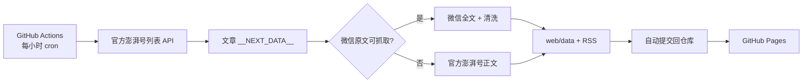

# 华农官微镜像 · SCAU WeChat Mirror

把华南农业大学官方微信公众号的公开推文，整理成一份可以随时搜索、按时间回看的静态网站。

- 站点：<https://icxin.github.io/scau-wechat-mirror/>
- 数据同步：GitHub Actions，每小时一次
- 站点托管：GitHub Pages
- 抓取位置：**只在 GitHub Actions 的云端 runner 上发起网络请求**，不在你的本机运行爬虫

> 非官方、非营利镜像。所有内容版权归华南农业大学及原作者所有，每篇文章均保留微信原文与官方澎湃号链接。

---

## 为什么这样设计

微信公众号对机房 IP 有较强的风控。直接在 GitHub Actions 里抓搜狗微信搜索，很容易遇到验证码或空白页；而把爬虫放到本机运行，又会暴露你的公网 IP。

因此这个项目采用**双源正文**策略：

1. **发现文章**：读取华南农业大学官方澎湃号（认证政务号 `6903558`）的分页接口。该账号由学校官方运营，内容与官微同步，且对云端访问友好。
2. **增强正文**：从每篇官方澎湃号文章中解析“阅读原文”的微信链接，尝试抓取微信原文全文。
3. **自动回退**：如果微信原文触发风控或没有正文节点，就保留官方澎湃号正文，文章不会缺席；站点会在卡片上标注「微信原文」或「官方澎湃号」。
4. **归档展示**：清洗 HTML、写入静态 JSON、生成 RSS，提交回仓库，由 GitHub Pages 直接托管。



整个链路没有一步需要你的电脑保持开机，也不会从你的本地网络访问微信或澎湃。

---

## 目录结构

```
.
├─ .github/workflows/sync.yml   # 定时同步 + 提交数据 + 部署 Pages
├─ scripts/
│  ├─ sync.py                   # 抓取、正文清洗、索引与 RSS 生成
│  └─ requirements.txt
├─ web/                         # GitHub Pages 站点（纯静态）
│  ├─ index.html
│  ├─ assets/
│  │  ├─ style.css
│  │  ├─ app.js
│  │  └─ favicon.svg
│  ├─ data/
│  │  ├─ index.json             # 文章索引（站点读取）
│  │  └─ articles/<id>.json     # 单篇正文（阅读页按需读取）
│  ├─ feed.xml                  # 同步后自动生成
│  ├─ robots.txt
│  └─ .nojekyll
└─ README.md
```

---

## 部署步骤

### 1. 仓库

本项目已经在 `iCxin/scau-wechat-mirror` 创建并推送。如果你想 fork 到自己的账号，改一下这几处：

- `scripts/sync.py` 顶部的 `SITE_URL` 与 `REPO_URL` 默认值
- `.github/workflows/sync.yml` 里的 `SITE_URL`

### 2. 启用 GitHub Pages

打开仓库 **Settings → Pages → Build and deployment**，把 **Source** 设为 **GitHub Actions**。

工作流也会尝试通过 API 自动启用 Pages；如果它提示 `build_type=legacy` 或没有权限，就按上面的路径手动点一次即可。未启用时，数据仍会正常同步和提交，只是站点不会部署。

### 3. 首次同步

- 推送到 `main` 会自动触发一次工作流；
- 也可以在 **Actions → Sync SCAU WeChat Mirror → Run workflow** 手动运行。

首次运行默认抓取最新 40 篇，用来快速铺满首页。之后每次默认抓取 12 篇新增文章。

### 4. 回填历史文章（可选）

在 **Run workflow** 时填写：

| 输入 | 含义 | 建议值 |
|---|---|---|
| `max_new` | 本次最多抓取的新文章数 | 首次回填可用 `60`，不要一次太大 |
| `discover_pages` | 列表抓取页数，每页 20 条 | `20` 表示最近约 400 条 |

回填可以分多次运行完成，脚本会自动去重并保留已有文章。

---

## 重要：不要在本机跑抓取

请**不要**在你的电脑上执行：

```bash
python scripts/sync.py
```

这会让微信 / 澎湃看到你的本地公网 IP，也违背本项目“只在 GitHub 运行”的约束。

如果你只是想预览页面样式，可以起一个纯静态服务器（它不会发起任何抓取）：

```bash
python -m http.server 8080 --directory web
```

---

## 可调参数

在 `.github/workflows/sync.yml` 的 `Sync articles` 步骤里：

| 环境变量 | 默认值 | 说明 |
|---|---|---|
| `SCAU_ACCOUNT_NAME` | `华南农业大学` | 展示用公众号名称，也用于校验微信原文账号 |
| `SCAU_WECHAT_ID` | `scauxmt` | 官微微信号 |
| `SCAU_PAPER_ID` | `6903558` | 官方澎湃号 id（列表接口需要） |
| `MAX_NEW` | 空 | 留空时：首次 40，之后 12 |
| `DISCOVER_PAGES` | 空 | 留空时：首次 10，之后 5 |
| `WECHAT_FETCH` | `1` | 是否尝试抓取微信原文；设为 `0` 则只用澎湃号正文 |
| `WECHAT_MAX` | `20` | 单次最多尝试多少篇微信原文，避免请求过多 |
| `MAX_ARTICLES` | `3000` | 索引最多保留多少篇（按时间保留最新） |

站点文案、颜色、栏目等都在 `web/` 下，直接改静态文件即可，无需构建。

---

## 数据说明

`web/data/index.json` 是站点唯一的数据入口，主要字段：

```json
{
  "account": { "name": "华南农业大学", "wechat_id": "scauxmt", "repo_url": "..." },
  "generated_at": "2026-11-08T12:00:00+08:00",
  "sync": {
    "last_success": "2026-11-08T12:00:00+08:00",
    "last_new": 3,
    "last_wechat": 2,
    "last_failed": 0
  },
  "stats": { "total": 120, "wechat": 98, "paper": 22, "latest": "..." },
  "articles": [
    {
      "id": "34417470",
      "title": "华农，特等奖！总数全省第一！",
      "published_at": "2026-11-04T17:26:00+08:00",
      "summary": "……",
      "cover": "https://...",
      "tags": ["科研"],
      "source": "wechat",
      "original_url": "https://mp.weixin.qq.com/s/...",
      "paper_url": "https://m.thepaper.cn/newsDetail_forward_34417470",
      "word_count": 1200
    }
  ]
}
```

正文详情位于 `web/data/articles/<id>.json`，包含清洗后的 `content_html`。图片保留原始 CDN 链接，页面通过 `referrerpolicy="no-referrer"` 加载；如果图片失效，前端会显示「华农」占位图。

---

## 运行与维护

- **定时频率**：每小时第 23 分钟。GitHub 免费定时任务在高峰期可能延迟几分钟到几十分钟，属正常现象。
- **60 天无活动**：GitHub 可能暂停定时工作流。本项目在有新文章时会自动提交，仓库保持活跃；如果长时间没有新文章，可以手动 Run workflow 一次。
- **微信风控**：脚本检测到「环境异常 / 访问过于频繁 / 验证码」时不会重试轰炸，而是直接回退到官方澎湃号正文。
- **失败不影响站点**：单篇文章失败会跳过；列表接口失败会保留现有数据，不会清空站点。
- **Pages 未启用**：工作流会输出 warning，数据仍会提交；启用 Pages 后下一次运行自动部署。
- **删除文章**：删除 `web/data/articles/<id>.json`，并从 `web/data/index.json` 的 `articles` 数组移除对应条目；或开 issue 说明。

---

## 常见问题

**Q：为什么不用搜狗微信搜索直抓？**  
A：GitHub Actions 的机房 IP 很容易被搜狗微信搜索拦截，轻则验证码，重则整页空白，24 小时稳定性无法保证。当前方案用学校官方澎湃号做发现，再尽量增强为微信原文，既能覆盖更新，也能保留原文链接。脚本里也保留了微信原文抓取能力，未来如果风控放松，无需换架构。

**Q：会不会暴露我的 IP？**  
A：不会。所有抓取请求都发生在 GitHub 托管的 runner 上；你的本地只用于编辑文件和查看网页。请务必不要在本机执行 `scripts/sync.py`。

**Q：这是学校官方站吗？**  
A：不是。本站是非官方、非营利的公开内容归档。内容版权归华南农业大学所有，站点每篇都注明来源并链接原文。如权利人认为不妥，请通过 issue 联系删除。

**Q：能改成别的公众号吗？**  
A：可以，但需要该账号有对应的官方澎湃号（拿到 `pphId`），并修改 `SCAU_PAPER_ID`、`SCAU_ACCOUNT_NAME`、`SCAU_WECHAT_ID`。如果只有微信公众号、没有澎湃号，建议改用 RSSHub、wewe-rss 等成熟项目，或配置代理。

---

## 参考与致谢

- 数据来源：[华南农业大学官方澎湃号](https://m.thepaper.cn/gov_6903558)（认证政务号）
- 列表接口与详情结构参考了 [RSSHub](https://github.com/DIYgod/RSSHub) 的 `thepaper` 路由实现
- 微信公众号抓取思路参考了 [WechatSogou](https://github.com/chyroc/WechatSogou)、[wewe-rss](https://github.com/cooderl/wewe-rss) 等开源项目
- 托管与调度：GitHub Actions、GitHub Pages

## License

代码以 MIT 许可发布。镜像中的文章、图片及其他内容版权归华南农业大学及原作者所有，本项目仅作公开信息的非营利归档，不构成官方发布。
